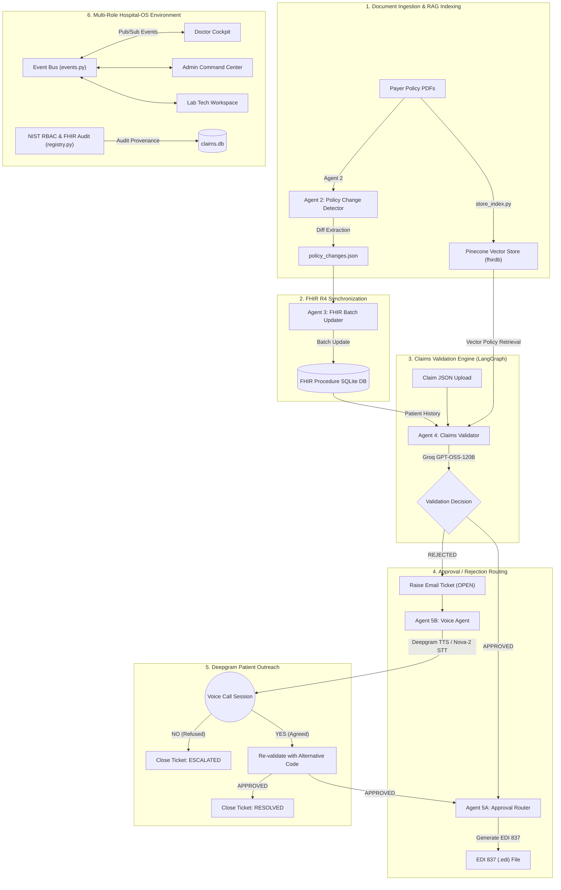

# 🏥 Hospital-OS & FHIRFlow: Multi-Agent Healthcare Operating System & Claims Engine

An end-to-end, multi-role agentic healthcare platform powered by **LangGraph**, **Groq GPT-OSS-120B**, **Deepgram**, **Pinecone**, **Redis**, and **HL7 FHIR**.

This repository contains the complete architecture and implementation of **Hospital-OS** — a unified platform bringing together **Doctors**, **Hospital Administrators**, **Lab Technicians**, and **Patients**. The platform combines a 5-agent claims RAG validation pipeline, real-time Deepgram AI voice patient outreach, 5-domain surgical readiness scorecards, dynamic bottleneck intelligence tracing, and an asynchronous pub/sub Event Bus.

---

## 📋 Table of Contents

- [Architectural Overview & Core Idea](#architectural-overview--core-idea)
- [System Architecture Flowchart](#system-architecture-flowchart)
- [Deep-Dive Agent Directory by Scope](#deep-dive-agent-directory-by-scope)
  - [Scope 1: Insurance Claims & Policy Validation Pipeline](#scope-1-insurance-claims--policy-validation-pipeline-langgraph)
  - [Scope 2: Doctor Cockpit Agents](#scope-2-doctor-cockpit-agents)
  - [Scope 3: Admin Command Hub Agents](#scope-3-admin-command-hub-agents)
  - [Scope 4: Lab Tech Workspace Agents & Workflows](#scope-4-lab-tech-workspace-agents--workflows)
  - [Scope 5: Patient Care Hub & Communication Agents](#scope-5-patient-care-hub--communication-agents)
- [Decoupled Hospital Event Bus (Pub/Sub)](#decoupled-hospital-event-bus-pubsub)
- [NIST AI RMF Security & FHIR Audit Provenance](#nist-ai-rmf-security--fhir-audit-provenance)
- [Complete Technology Stack](#complete-technology-stack)
- [Database Models & Schemas](#database-models--schemas)
- [Complete REST API Reference](#complete-rest-api-reference)
- [Setup & Installation Guide](#setup--installation-guide)

---

## Architectural Overview & Core Idea

Modern healthcare systems suffer from severe friction between clinical delivery and administrative pre-authorization:

1. **Medical Claim Denials**: 15–20% of healthcare claims are rejected by payers due to undisclosed policy updates, dosage limits (e.g., Vitamin B12 injections $> 1000\,\text{mcg}$ requiring prior auth), or missing coding modifiers (CPT/HCPCS/SNOMED). Traditional manual appeals take up to 45 days.
2. **Surgical Pre-Op Delays**: Operating theater (OT) schedules stall when pre-operative clinical prerequisites (ECG/Troponin lab results, chest X-rays, blood bank reservations, insurance pre-authorizations) are managed in isolated departmental silos.

**Hospital-OS** solves both challenges by deploying **17 specialized AI agents** across 5 distinct operational scopes, synchronized via a real-time Event Bus and secured by HL7 FHIR compliance standards.

---

## System Architecture Flowchart



---

## Deep-Dive Agent Directory by Scope

---

### Scope 1: Insurance Claims & Policy Validation Pipeline (LangGraph)

Orchestrated via **LangGraph** in [`langgraph_workflow.py`](file:///d:/Data%20Science/SIH/Datathon-CIT/langgraph_workflow.py).

#### 1. Agent 2: Policy Change Detector
- **File**: [`agents/agent2/agent2.py`](file:///d:/Data%20Science/SIH/Datathon-CIT/agents/agent2/agent2.py)
- **Idea & Purpose**: Automates the detection of policy changes between newly downloaded payer PDFs and historical policy vectors in Pinecone.
- **Workflow & Execution Flow**:
  1. Loads new policy PDFs downloaded from payer portals.
  2. Generates a summary of the new policy using Groq LLM.
  3. Queries Pinecone (`fhirdb` index) for the corresponding old policy vector using metadata filters (e.g., code `J3420`).
  4. Prompts Groq GPT-OSS-120B with both old and new policy text to extract structured diffs (prior auth changes, dose limits, CPT code restrictions, effective dates).
  5. Outputs timestamped `policy_changes_<timestamp>.json` and upserts new policy embeddings into Pinecone.
- **Inputs**: Policy PDF files.
- **Outputs**: `policy_changes.json` containing `code`, `change`, `impact`, `affected_codes`, `details`.

#### 2. Agent 3: FHIR Batch Updater
- **File**: [`agents/agent3/agent3.py`](file:///d:/Data%20Science/SIH/Datathon-CIT/agents/agent3/agent3.py)
- **Idea & Purpose**: Synchronizes policy changes directly with the patient procedure database adhering to the **HL7 FHIR R4 Procedure resource schema**.
- **Workflow & Execution Flow**:
  1. Consumes `policy_changes.json` generated by Agent 2.
  2. Connects to [`fhir_procedure_db.sqlite`](file:///d:/Data%20Science/SIH/Datathon-CIT/agents/agent3/fhir_procedure_db.sqlite).
  3. Processes updates in batches of 100 procedure records.
  4. Flags procedures violating new policy requirements, updates `statusReason` fields, and inserts entries into `procedure_policy_flags`.
  5. Appends immutable audit records to `audit_log`.
- **Inputs**: `policy_changes.json`.
- **Outputs**: Updated SQLite procedure records & audit logs (`total_affected`, `procedures_updated`, `procedures_flagged`).

#### 3. Agent 4: Claims RAG Validator
- **File**: [`agents/agent4/agent4.py`](file:///d:/Data%20Science/SIH/Datathon-CIT/agents/agent4/agent4.py)
- **Idea & Purpose**: The core RAG reasoning engine. Validates incoming claims against historical patient FHIR records and live vector policy documents.
- **Workflow & Execution Flow**:
  1. Receives a claim JSON object (`patient_id`, `code`, `dose`, `units`, `diagnosis`, `date_of_service`).
  2. Fetches 12-month procedure history and active policy flags for the patient from the FHIR database.
  3. Performs semantic similarity vector search against Pinecone (`fhirdb`) using HuggingFace `all-MiniLM-L6-v2` embeddings to retrieve exact governing policy rules.
  4. Prompts **Groq GPT-OSS-120B** (`openai/gpt-oss-120b`) with patient records, claim details, policy rules, and historical frequency.
  5. Parses JSON output returning `decision` (`APPROVED`/`REJECTED`), `confidence`, `reasoning`, `policy_citations`, and `suggested_alternatives`.
  6. Immediately writes the decision to the `claims` table in `claims.db` to refresh UI dashboard counters.
- **Inputs**: Claim JSON payload.
- **Outputs**: JSON decision object with reasoning, policy citations, and alternative CPT codes (e.g., `G0008`).

#### 4. Agent 5A: Approval Router
- **File**: [`agents/agent5/agent5a.py`](file:///d:/Data%20Science/SIH/Datathon-CIT/agents/agent5/agent5a.py)
- **Idea & Purpose**: Converts approved claims into industry-standard electronic claim formats ready for clearinghouse submission.
- **Workflow & Execution Flow**:
  1. Consumes `APPROVED` decision objects from Agent 4 or post-voice correction.
  2. Fetches complete patient and billing provider demographics.
  3. Generates a standard **X12 EDI 837 Professional Claim** file formatted with `ISA`, `GS`, `ST`, `BHT`, `NM1`, `CLM`, and `SV1` segments.
  4. Saves `.edi` submission files to disk and logs submission records in `claim_submissions`.
- **Inputs**: Approved decision dict.
- **Outputs**: `.edi` electronic submission file & DB record.

#### 5. Agent 5B: Voice Outreach Agent
- **File**: [`agents/agent5/agent5b.py`](file:///d:/Data%20Science/SIH/Datathon-CIT/agents/agent5/agent5b.py)
- **Idea & Purpose**: Conducts real-time interactive AI voice calls to patients for rejected claims, offering automated claim corrections.
- **Workflow & Execution Flow**:
  1. Activated when Agent 4 returns `REJECTED`. Automatically calls `raise_ticket()` in [`ticket_notifier.py`](file:///d:/Data%20Science/SIH/Datathon-CIT/ticket_notifier.py) to send an `OPEN` email ticket.
  2. Spawns an isolated daemon thread with a dedicated `asyncio` event loop to avoid deadlocking LangGraph.
  3. Synthesizes rejection intro speech via **Deepgram TTS** (Aura Asteria model over WebSocket) and plays audio via PyAudio.
  4. Opens microphone input stream via PyAudio and sends 16kHz linear16 PCM audio to **Deepgram Nova-2 STT** WebSocket.
  5. Transcribes user speech and prompts Groq LLM to classify intent (`YES` to agree to fix, `NO` to refuse).
  6. **If `YES`**: Updates procedure code to suggested alternative (`G0008`), triggers secondary validation with Agent 4, routes approved claim to Agent 5A, and sends a `RESOLVED` email ticket.
  7. **If `NO`**: Marks claim as escalated and sends an `ESCALATED` email ticket.
- **Inputs**: Rejected claim dict + patient contact details.
- **Outputs**: Patient intent (`YES`/`NO`), corrected claim re-validation, and closed email ticket.

---

### Scope 2: Doctor Cockpit Agents

Located in [`agents/doctor_agents.py`](file:///d:/Data%20Science/SIH/Datathon-CIT/agents/doctor_agents.py).

```
┌────────────────────────────────────────────────────────────────────────┐
│                        DOCTOR COCKPIT AGENTS                           │
├────────────────────────────────────────────────────────────────────────┤
│ 1. Surgery Readiness Agent   │ 5-Domain Checklist Evaluator (0-100%)   │
│ 2. Clinical Clearance Agent  │ ASA Physical Score & Vitals Evaluator   │
│ 3. Scan Dispatcher Agent     │ HL7 FHIR ServiceRequest Generator       │
│ 4. Doctor AI Assistant       │ Natural Language Chat with Redis Cache  │
└────────────────────────────────────────────────────────────────────────┘
```

#### 6. Surgery Readiness Coordinator Agent
- **Core Idea**: Calculates a live **Surgery Readiness Scorecard (0–100%)** across 5 clinical domains to clear patients for surgery without operational delays.
- **Execution Loop (`Sense` → `Plan` → `Act`)**:
  - **Sense**: Queries SQLite DB for completed lab scans (ECG/Troponin), pre-op radiology (Chest X-Ray), blood bank 2-unit RBC reservation (`#BB-902`), insurance pre-authorization approval, and operating theater allocation (`OT #1`).
  - **Plan**: Evaluates how many checkpoints are verified. Calls Groq GPT-OSS-120B to generate a 2-sentence clinical readiness summary.
  - **Act**: Pushes live readiness score (e.g., `100% READY FOR SURGERY`) to Doctor Cockpit and emits `SURGERY_READINESS_UPDATED` event to the Event Bus.

#### 7. Clinical Pre-Op Clearer Agent
- **Core Idea**: Evaluates real-time EHR vitals and anesthesia risk to grant clinical pre-op clearance.
- **Execution Loop (`Sense` → `Plan` → `Act`)**:
  - **Sense**: Ingests patient vitals (Heart Rate 72 bpm, BP 120/80, SpO2 98%, Temp 37.0°C, Resp Rate 16), ASA Physical Status Score (`ASA_II`), and Mallampati Airway Class (Class II).
  - **Plan**: Verifies vitals fall within cardiac risk index thresholds ($<0.9\%$ complication rate). Prompts Groq LLM for an anesthesia clearance opinion.
  - **Act**: Issues formal clearance certificate and logs an immutable HL7 FHIR `AuditEvent` to SQLite via [`registry.py`](file:///d:/Data%20Science/SIH/Datathon-CIT/registry.py).

#### 8. Diagnostic Scan Dispatcher Agent
- **Core Idea**: Formats doctor scan orders into standardized HL7 FHIR `ServiceRequest` items.
- **Execution Loop (`Sense` → `Plan` → `Act`)**:
  - **Sense**: Captures scan order requests (CT Scan, MRI, Ultrasound) submitted by doctors.
  - **Plan**: Formats order into HL7 FHIR `ServiceRequest` JSON schema with priority tags (`URGENT`/`ROUTINE`).
  - **Act**: Inserts order into `scans` table and emits `SCAN_ORDERED` event to notify Lab Technicians.

#### 9. Doctor AI Assistant Chatbot
- **Core Idea**: Provides doctors with instant natural language query responses for schedules, patient history, and clearances using **Redis Memory Cache**.
- **Execution Loop**:
  - Receives prompt → Computes MD5 hash cache key (`doctor_chat:<hash>`).
  - Queries Redis (or in-memory fallback). On cache hit, returns instant response.
  - On cache miss, sends prompt to Groq LLM (`openai/gpt-oss-120b`), returns response, and sets Redis key with 300s TTL.

---

### Scope 3: Admin Command Hub Agents

Located in [`agents/admin_agents.py`](file:///d:/Data%20Science/SIH/Datathon-CIT/agents/admin_agents.py).

#### 10. Operation Claims Pre-Approval Agent
- **Core Idea**: Automatically filters and pre-approves insurance claims specifically for patients scheduled or requested for surgical operations.
- **Execution Loop (`Sense` → `Plan` → `Act`)**:
  - **Sense**: Polls `claims` table and cross-references active surgical candidates from `surgeries` table.
  - **Plan**: Identifies surgical operation claims (e.g., CABG, Knee Arthroplasty) and prompts Groq LLM to generate an executive pre-op clearance summary.
  - **Act**: Updates pre-op clearances in Admin Command Hub and emits `OPERATION_CLAIMS_PROCESSED` event.

#### 11. OT & Bed Resource Optimizer Agent
- **Core Idea**: Optimizes hospital bed capacity and Operating Theater scheduling.
- **Execution Loop (`Sense` → `Plan` → `Act`)**:
  - **Sense**: Reads `hospital_capacity` table for total/occupied/available beds (e.g., 108/150 occupied) and total/in-use/available OTs (e.g., 3/8 in use).
  - **Plan**: Calculates Bed Occupancy Rate (%) and OT Utilization Rate (%). Asks Groq LLM for 2 actionable resource optimization recommendations.
  - **Act**: Pushes metrics to Admin Command Center and emits `OT_RESOURCE_OPTIMIZED` event.

#### 12. Bottleneck Intelligence Tracer
- **File**: Defined in [`app.py`](file:///d:/Data%20Science/SIH/Datathon-CIT/app.py) (`/api/bottleneck/trace`).
- **Core Idea**: Diagnoses operational delay bottlenecks across patient encounter timelines.
- **Execution Loop**:
  - Traces patient stages: Consultation (25 mins), Pre-Op Blood Work (30 mins), CT Imaging Scan (45 mins queue delay), Insurance Auth Clearance (92 mins delay).
  - Pinpoints primary cause: 3-patient queue backlog at Scanner #2 and missing pre-auth update from Agent 4.
  - Recommends resolution: Reroute scan to idle Scanner #1 and trigger Voice Agent 5B patient confirmation call.

#### 13. Admin AI Assistant Chatbot
- **Core Idea**: Executive assistant for hospital administrators backed by Groq LLM and Redis Memory Caching.
- **Execution Loop**: Hashes query → Checks Redis Cache → On miss, invokes Groq LLM with admin context → Caches result → Returns strategy response.

---

### Scope 4: Lab Tech Workspace Agents & Workflows

Integrated in [`app.py`](file:///d:/Data%20Science/SIH/Datathon-CIT/app.py), [`database.py`](file:///d:/Data%20Science/SIH/Datathon-CIT/database.py), and [`events.py`](file:///d:/Data%20Science/SIH/Datathon-CIT/events.py).

#### 14. Diagnostic Work Order Processor
- **Core Idea**: Queue management engine for lab technicians.
- **Execution Loop**: Listens for `SCAN_ORDERED` events → Populates pending work orders (`SCAN001`, `SCAN002`) in Lab Tech Workspace → Displays priority tags (`URGENT`/`ROUTINE`).

#### 15. Lab Result Uploader & Event Publisher
- **Core Idea**: Processes lab test results and automatically triggers surgical readiness updates.
- **Execution Loop**:
  - Lab Tech submits test results (ECG, Troponin < 0.01 ng/mL, CT Angiogram findings) via `/api/lab/submit`.
  - Inserts report into `fhir_diagnostic_reports` table.
  - Emits `LAB_RESULT_READY` event over Event Bus.
  - Automatically updates Surgery Readiness Scorecard in Doctor Cockpit.

---

### Scope 5: Patient Care Hub & Communication Agents

Located in [`ticket_notifier.py`](file:///d:/Data%20Science/SIH/Datathon-CIT/ticket_notifier.py) and [`agent5b.py`](file:///d:/Data%20Science/SIH/Datathon-CIT/agents/agent5/agent5b.py).

#### 16. Care Plan & Claims Status Monitor
- **Core Idea**: Patient-facing dashboard displaying active health records, procedure history, and claim authorization status.

#### 17. Email Ticket Lifecycle Manager
- **File**: [`ticket_notifier.py`](file:///d:/Data%20Science/SIH/Datathon-CIT/ticket_notifier.py)
- **Core Idea**: Professional SMTP email ticketing system managing claim rejections and appeals.
- **Execution Loop**:
  - **Ticket Raised (`OPEN`)**: Triggered when Agent 4 rejects claim. Sends HTML email containing claim ID, rejection reason, priority badge (`CRITICAL`/`HIGH`/`MEDIUM`/`LOW`), and alternative codes.
  - **Ticket Closed (`RESOLVED`)**: Sent after patient agrees via Voice Agent 5B and corrected claim is approved.
  - **Ticket Escalated (`ESCALATED`)**: Sent if patient refuses voice correction.
  - **Ticket Failed (`FAILED`)**: Sent if patient agrees but secondary validation still fails.

---

## Decoupled Hospital Event Bus (Pub/Sub)

Implemented in [`events.py`](file:///d:/Data%20Science/SIH/Datathon-CIT/events.py). Decouples micro-agent state transitions from UI rendering:

```python
# Publish Event Example
events.publish_event(
    event_type="LAB_RESULT_READY",
    payload={"claim_id": "CLM001", "test_name": "Pre-Op ECG", "result": "Normal Sinus Rhythm"},
    source_agent="LabAgent_Agent3"
)
```

1. **Persistence**: All events are inserted into `hospital_events` table in SQLite (`id`, `event_type`, `payload`, `source_agent`, `timestamp`).
2. **Subscribers**: In-memory callbacks execute synchronously to notify registered UI handlers.

---

## NIST AI RMF Security & FHIR Audit Provenance

Implemented in [`registry.py`](file:///d:/Data%20Science/SIH/Datathon-CIT/registry.py):

### 1. Role-Based Access Control (RBAC) Matrix
```python
ROLE_PERMISSIONS = {
    "DOCTOR": ["view_patient_records", "view_surgery_readiness", "approve_surgery_clearance", "trigger_claims_agent"],
    "ADMIN":  ["view_command_center", "view_bottleneck_intelligence", "manage_claims_engine", "view_escalation_tickets"],
    "LAB_TECH": ["view_pending_lab_orders", "upload_lab_results", "emit_lab_ready_event"],
    "PATIENT": ["view_my_claims", "interact_voice_agent_5b", "view_care_plan"]
}
```

### 2. Immutable FHIR AuditEvent Logging
All sensitive agent executions call `log_audit_event()`, inserting records into `fhir_audit_events` table:
```json
{
  "agent_id": "DoctorAgent_Clearance",
  "role": "DOCTOR",
  "action": "GRANT_CLINICAL_CLEARANCE",
  "target_resource": "pat001",
  "status": "SUCCESS",
  "reasoning": "Vitals stable. ASA Class ASA_II approved."
}
```

---

## Complete Technology Stack

| Layer | Component | Description |
|---|---|---|
| **Agent Orchestration** | LangGraph (`StateGraph`, `MemorySaver`) | Multi-agent execution workflow in [`langgraph_workflow.py`](file:///d:/Data%20Science/SIH/Datathon-CIT/langgraph_workflow.py) |
| **LLM Inference** | Groq API (`openai/gpt-oss-120b`) | Ultra-fast LLM reasoning across Agents 2, 4, 5B, Doctor, and Admin agents |
| **Vector DB** | Pinecone (`fhirdb` index) | Medical policy vector storage |
| **Embeddings** | HuggingFace `all-MiniLM-L6-v2` | Policy text embedding generation |
| **Voice Speech-to-Text** | Deepgram Nova-2 (WebSocket) | Real-time 16kHz linear16 microphone audio transcription |
| **Voice Text-to-Speech** | Deepgram Aura Asteria (WebSocket) | Natural streaming audio voice synthesis |
| **Audio I/O** | PyAudio | Microphone reading & speaker playback |
| **Caching Layer** | Redis (Local + In-Memory Fallback) | Instant AI assistant prompt responses |
| **Databases** | SQLite (`claims.db` & `fhir_procedure_db.sqlite`) | Persistence for claims, surgeries, doctors, capacity, and FHIR data |
| **Standards Compliance**| HL7 FHIR R4 & X12 EDI 837P | Medical procedure records and EDI claim format generation |
| **Backend API** | FastAPI + Uvicorn | Async REST server in [`app.py`](file:///d:/Data%20Science/SIH/Datathon-CIT/app.py) |
| **Frontend UI** | Next.js (React 19 + TypeScript + Tailwind CSS) | Enterprise role-governed portals in [`frontend/`](file:///d:/Data%20Science/SIH/Datathon-CIT/frontend/) |
| **Observability** | LangSmith Client | Tracing LLM execution, accuracy scores, and feedback |

---

## Database Models & Schemas

### `claims.db` Schema:
- **`claims`**: `id` (PK), `patient_id`, `procedure_code`, `description`, `dose`, `units`, `date_of_service`, `diagnosis`, `status`, `decision`, `reasoning`, `confidence`, `created_at`, `processed_at`
- **`doctors`**: `id` (PK), `name`, `specialty`, `status`, `current_location`, `on_duty`, `shift_timing`, `phone`
- **`surgeries`**: `id` (PK), `doctor_id`, `doctor_name`, `patient_id`, `patient_name`, `procedure_name`, `operating_theater`, `scheduled_time`, `duration_mins`, `readiness_score`, `status`
- **`scans`**: `id` (PK), `doctor_id`, `doctor_name`, `patient_id`, `patient_name`, `scan_name`, `body_part`, `priority`, `status`, `result_summary`, `uploaded_by`
- **`hospital_capacity`**: `id` (PK=1), `total_beds`, `occupied_beds`, `available_beds`, `total_ots`, `in_use_ots`, `maintenance_ots`, `available_ots`
- **`fhir_diagnostic_reports`**: `id` (PK), `claim_id`, `test_name`, `result_value`, `tech_id`, `timestamp`
- **`fhir_audit_events`**: `id` (PK), `agent_id`, `role`, `action`, `target_resource`, `status`, `reasoning`, `timestamp`
- **`hospital_events`**: `id` (PK), `event_type`, `payload`, `source_agent`, `timestamp`

---

## Complete REST API Reference

| Scope | Method | Endpoint | Description |
|---|---|---|---|
| **Claims** | `POST` | `/api/upload` | Upload claim JSON & start LangGraph workflow |
| | `GET` | `/api/claims` | Fetch recent processed claims |
| | `GET` | `/api/stats` | Fetch dashboard metrics (total, approved, rejected, tickets) |
| **Workflows**| `GET` | `/api/workflow/{id}` | Get full state of a workflow |
| | `GET` | `/api/workflow/{id}/messages` | Poll live agent execution logs |
| | `POST` | `/api/workflow/{id}/voice-response` | Submit patient UI YES/NO response |
| **Doctor** | `GET` | `/api/doctors` | List doctors roster and duty status |
| | `GET` | `/api/surgeries` | List upcoming surgeries |
| | `POST` | `/api/scans/order` | Doctor uploads diagnostic scan order |
| | `POST` | `/api/doctor/agent/readiness` | Execute Surgery Readiness Coordinator Agent |
| | `POST` | `/api/doctor/agent/clearance` | Execute Clinical Pre-Op Clearance Agent |
| | `POST` | `/api/doctor/chat` | Execute Doctor AI Assistant Chatbot |
| **Admin** | `GET` | `/api/admin/hospital-capacity` | Get Bed and OT availability metrics |
| | `GET` | `/api/admin/ot-requests` | Get pending OT booking requests |
| | `POST` | `/api/admin/agent/operation-claims` | Execute Operation Claims Pre-Approval Agent |
| | `POST` | `/api/admin/agent/resource-optimizer` | Execute OT & Bed Resource Optimizer Agent |
| | `POST` | `/api/admin/insurance/approve` | Approve surgical pre-auth & set readiness to 100% |
| | `POST` | `/api/admin/chat` | Execute Admin AI Assistant Chatbot |
| **Lab Tech** | `POST` | `/api/lab/submit` | Upload lab result → update DB → emit `LAB_RESULT_READY` |
| | `POST` | `/api/scans/complete` | Complete diagnostic scan work order |
| **Events/Audit**| `GET` | `/api/events` | Fetch live hospital event stream |
| | `POST` | `/api/events/publish` | Publish custom event to Event Bus |
| | `GET` | `/api/audit-trail` | Fetch FHIR AuditEvents compliance log |
| | `GET` | `/api/bottleneck/trace` | Trace encounter timeline to pinpoint delay bottlenecks |

---

## Setup & Installation Guide

### 1. Prerequisites
- Python 3.10+
- Node.js 18+ & `npm`
- `uv` package manager (`pip install uv`)
- `portaudio` system library (macOS: `brew install portaudio`, Ubuntu: `sudo apt-get install portaudio19-dev`)

### 2. Environment Variables (.env)
```env
GROQ_API_KEY=gsk_...
PINECONE_API_KEY=pcsk_...
DEEPGRAM_STT_KEY=...
DEEPGRAM_TTS_KEY=...

# Email Ticketing
TICKET_EMAIL_FROM=claims-system@yourorg.com
TICKET_EMAIL_TO=compliance@yourorg.com
SMTP_HOST=smtp.gmail.com
SMTP_PORT=587
SMTP_USER=your-smtp-user@gmail.com
SMTP_PASSWORD=your-app-password
```

### 3. Launching Backend & Frontend
```bash
# Terminal 1: Ingest Policy Vectors & Run Backend
uv run python store_index.py
python app.py

# Terminal 2: Start Next.js Frontend
cd frontend
npm install
npm run dev
```
*(Open `http://localhost:3000` to view the Hospital-OS role gateway)*